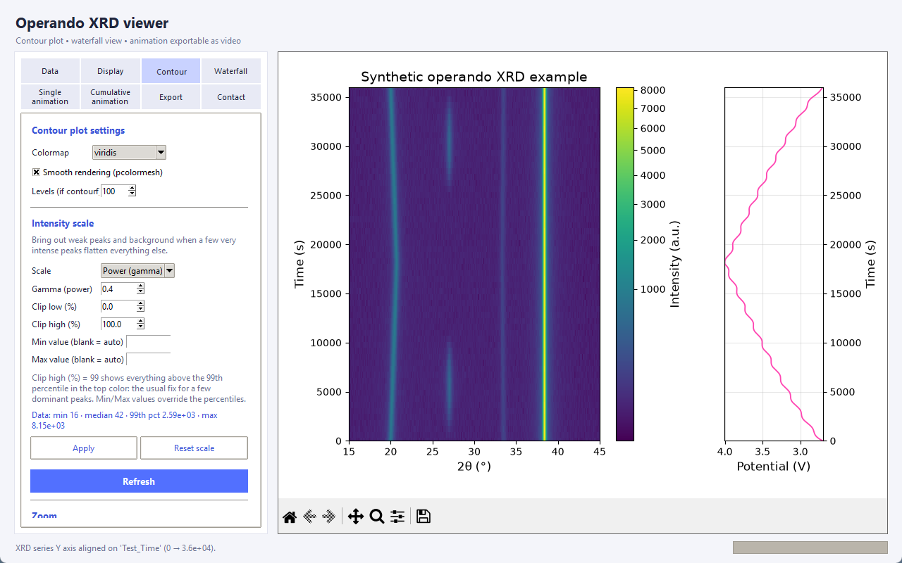
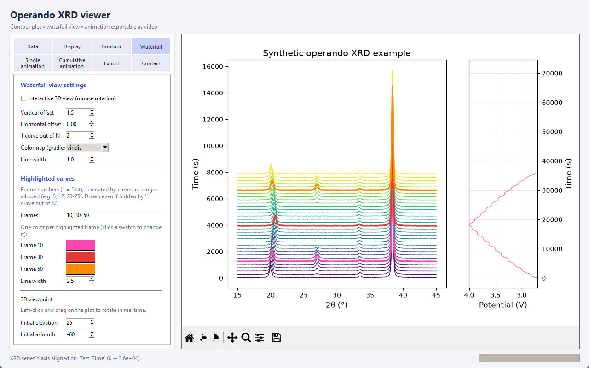
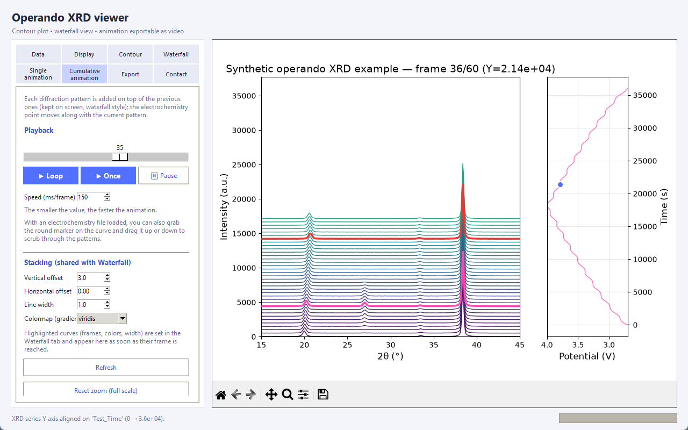

# Operando XRD viewer

A free, standalone desktop tool to explore **operando X-ray diffraction series**: stack hundreds of
patterns into a contour plot or a waterfall, play them as an animation, and show the
**electrochemical cycling curve** next to them, aligned on the same axis.



## Features

- **Contour plot** (2θ / time / intensity as colour) with an **intensity-scale control**
  (linear, square root, gamma, logarithmic, percentile clipping, min/max) so a few very intense peaks
  do not flatten the weak ones. Zoom on 2θ with the mouse or by typing a range.
- **Waterfall view**, 2D or interactive 3D, with horizontal/vertical offsets, a "1 curve out of N" filter,
  and **highlighted curves** (one colour per chosen pattern, thicker lines).
- **Single animation** (one pattern at a time) and **cumulative animation** (patterns pile up as the
  experiment progresses), both exportable as **MP4**.
- **Electrochemistry panel** (EC-Lab `.mpt` or generic `.csv`) next to every view. In the animations,
  a marker follows the current pattern on the curve, and you can **drag it** along the curve to scrub
  through the patterns.
- **Exports**: PDF / SVG (vector) and PNG for figures, MP4 for animations, and **CSV / Excel files
  of the data** (patterns as columns, intensity matrix, electrochemistry) to re-plot in Origin or Excel.

| Waterfall with highlighted curves | Cumulative animation |
|---|---|
|  |  |

## Download (Windows)

Get `OperandoViewer.exe` from the [**latest release**](https://github.com/jeannoelchotard/OperandoViewer/releases/latest)
and double-click it. No Python installation is needed.

> The executable is not code-signed, so Windows SmartScreen may show a warning the first time:
> click **More info → Run anyway**. The first start can take a few seconds.

macOS and Linux users: run the script with Python (see below).

## Run from source

Requires Python 3 with Tkinter (included in the standard Windows/macOS installers; on Debian/Ubuntu:
`sudo apt install python3-tk`). Developed and tested with Python 3.14.

```bash
pip install -r requirements.txt
python operando_viewer.py
```

For **MP4 export** you also need [ffmpeg](https://ffmpeg.org/) available in your PATH
(Windows: `winget install ffmpeg`, macOS: `brew install ffmpeg`, Linux: `sudo apt install ffmpeg`).

## Quick start with the example data

The `examples/` folder contains a small **synthetic** dataset (not a real measurement):

1. **Data** tab → *From a .buf file* → choose `examples/synthetic_series.buf`
   (or *Select files…* and pick the `.xy` files in `examples/synthetic_series/`).
2. **Data** tab → *Load .csv…* → choose `examples/synthetic_echem.csv`
   (the *Voltage* and *Test_Time* columns are selected automatically).
3. Switch between the **Contour**, **Waterfall** and **animation** tabs.

## Input formats

| Data | Format |
|---|---|
| Diffraction patterns | Plain-text files with two numeric columns (2θ, intensity): `.xy`, `.dat`, `.uxd`… Header and comment lines are skipped. Select the files directly (natural sort order), or give a `.buf` file listing one path per line (relative to the `.buf` file or absolute). |
| Time / Y axis of the series | Linear (start + step), a one-value-per-line CSV, or automatically aligned on the chosen electrochemistry column. |
| Electrochemistry | EC-Lab `.mpt` (header length, encoding and decimal comma handled), or a generic `.csv` (comma, semicolon or tab separated, with or without header). Any numeric column can be used for the X and Y axes. Columns that oscillate with charge/discharge (capacity, x in Li<sub>x</sub>…) can be "unwrapped" into a steadily increasing axis. |

## Build the Windows executable yourself

```bash
pip install pyinstaller
python -m PyInstaller --onefile --windowed --name OperandoViewer operando_viewer.py
```

The executable is created in `dist/`.

## Feedback, bugs and feature requests

Questions, bug reports or ideas for changes are welcome:

- open an [issue](https://github.com/jeannoelchotard/OperandoViewer/issues) on GitHub, or
- write to **Jean-Noël Chotard** — [jean-noel.chotard@u-picardie.fr](mailto:jean-noel.chotard@u-picardie.fr)

## Citation

If this software helps your research, please cite it (see [`CITATION.cff`](CITATION.cff); GitHub's
"Cite this repository" button gives ready-made BibTeX and APA entries).

## License

[MIT](LICENSE) © 2026 Jean-Noël Chotard
